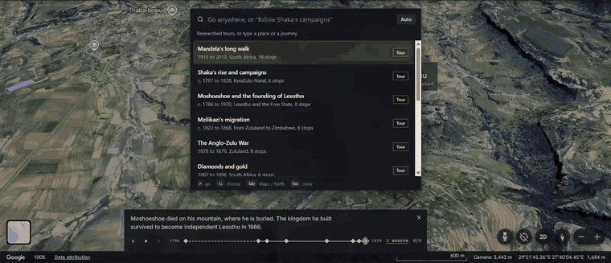
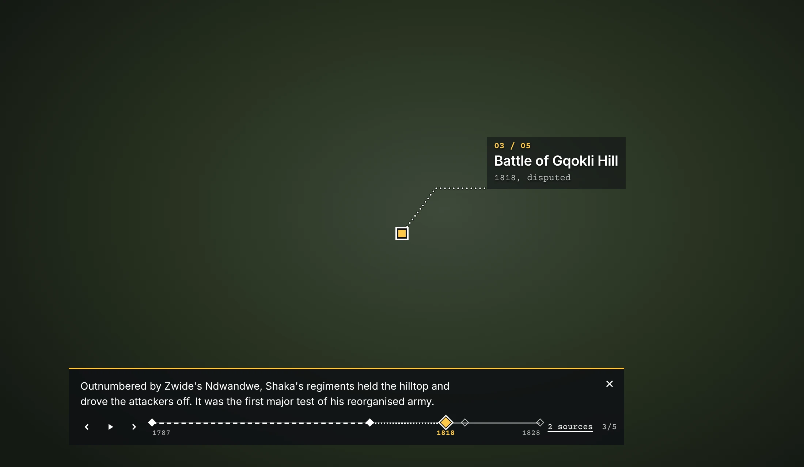
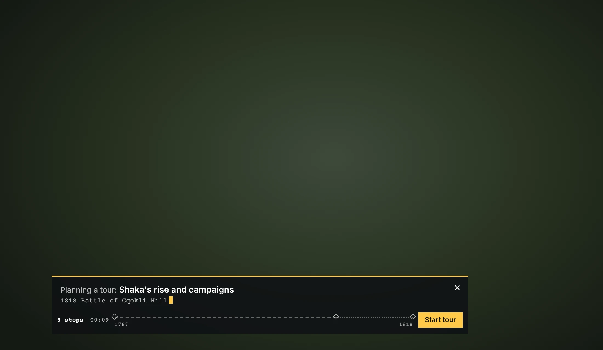
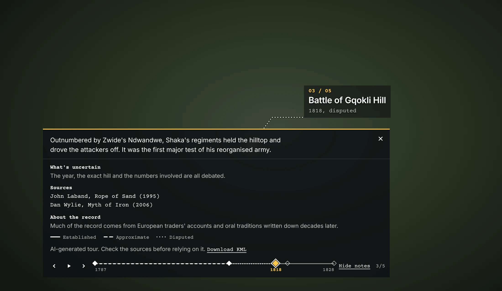

# Earth Tour

**Type a journey. Watch the globe fly it.**

[](https://orateng.com/work/earth-tour/)

<sub>“Follow the Silk Road”, generated live. Sped up 1.5×.</sub>

Earth Tour turns a phrase like *“follow Shaka’s campaigns”* into a stop-by-stop flight on the real globe. Each stop is marked on the map and narrated along the bottom, with a note on how sure historians are and where the account comes from. Type a plain question like *“highest mountain in the world”* and it just takes you there.

**Chrome / Edge extension · 13 researched tours · 103 stops · MIT · your Anthropic key stays in your browser**

> **Proof of concept** · v0.7.0 · November 2026
>
> Load it unpacked; it isn’t on the Chrome Web Store yet. The 13 researched tours open with **no API key**. Generated tours use your own [Anthropic key](https://console.anthropic.com/) and cost a few cents each.

**Contents:** [Try it](#try-it) · [What you get](#what-you-get) · [Why this exists](#why-this-exists) · [The design](#the-design) · [Preloaded tours](#preloaded-tours) · [Using it](#using-it) · [How it works](#how-it-works) · [Privacy and cost](#privacy-and-cost) · [Limits](#limits) · [Troubleshooting](#troubleshooting) · [Contributing](#contributing) · [Roadmap](#roadmap)

## Try it

1. Clone this repo: `git clone https://github.com/vitruvianman-za/earthtour`
2. Open `chrome://extensions` (or `edge://extensions`), turn on **Developer mode**, click **Load unpacked**, and choose the `extension` folder.
3. Open [Google Earth](https://earth.google.com/web/) and press **Alt+G** — or **Ctrl+K** on Earth or google.com/maps.
4. Pick one of the researched tours. No key needed. For a generated tour, paste an [Anthropic API key](https://console.anthropic.com/) in Settings.

Settings opens on first install and covers the key, **Fast** vs **Careful**, shortcuts, and clearing the cache. You can close it and still use the researched tours. Reload any Earth or Maps tabs that were already open.

To update later: `git pull`, then click **Reload** on the extension card.

## What you get

- **Any journey, not a fixed slideshow.** Name a journey; the route, narration and sources are written on demand.
- **Certainty you can see.** Established legs are solid, approximate dashed, disputed dotted — the convention real maps already use. A note says what exactly is uncertain.
- **Real sources per stop**, or “No sources cited” rather than an invented reference.
- **It starts before it finishes.** Stops stream in, and you can start at stop 1 while the rest is still being written.
- **13 researched southern African tours, 103 stops**, from Mapungubwe to June 16. Instant, no API call.
- **KML export**, smooth fly-to on Earth, and cached replays.
- **No backend.** Your key stays in `chrome.storage.local` and goes only to Anthropic.

## Why this exists

Google Earth already has curated stories, but someone has to choose to make each one. Most of history never gets a tour, and African history in particular is thin. Earth Tour generates one on demand for any journey you can name, and flies the route instead of showing a slideshow.

Generated history is only useful if it’s honest about its limits, so certainty is built into the design:

- **Line style means certainty, the way it does on real maps.** Surveyed borders are drawn solid, approximate ones dashed, disputed ones dotted. Earth Tour uses the same convention for the leader line to each stop’s label and for each leg of the timeline. *Established* means historians broadly agree, *approximate* means the event is accepted but the exact site or date isn’t, and *disputed* means historians disagree or the main sources are partisan.

- **Where something is uncertain, the stop says so** (“The year, the exact hill and the numbers involved are all debated”).

- **Sources are real, well-known works**, and a stop shows “No sources cited” rather than an invented reference.

- **Each tour notes where its record comes from**: oral tradition, colonial-era accounts, court chronicles.

## The design

The map is the interface. Nothing sits in a corner competing with it.

- **On the map:** an atlas-style label pinned to the stop, joined by a leader line in the stop’s certainty style. Satellite imagery is busy, so labels are white on a soft dark backing, with one survey-yellow highlight marking where you are.

- **Along the bottom:** a documentary-style band. The narration reads like subtitles, and the timeline underneath is the scrubber. Stops sit at their real years, so ten quiet years read as a gap and three battles in two years read as a cluster.

- **While a tour is planned**, Earth flies to the region straight away, and stops drop onto the timeline as they’re written. You can start as soon as stop 1 arrives.

[](docs/stop.webp)
<sub>A disputed stop: dotted leader, narration, and the timeline.</sub>

[](docs/planning.webp)
<sub>Stops land on the timeline as they’re written.</sub>

[](docs/notes.webp)
<sub>Notes on a disputed stop: what’s uncertain, sources, and the record.</sub>

## Preloaded tours

Thirteen researched tours of South African and southern African history ship with the extension: 103 stops, each with sources, a certainty label, and coordinates checked against Wikipedia. They open instantly, with no API call, and are labelled as researched rather than AI-generated.

| Kingdoms | Colonial era | Struggle | Deep time and first contact |
| --- | --- | --- | --- |
| Mapungubwe | The Anglo-Zulu War | Mandela’s long walk | Human origins |
| Shaka’s rise and campaigns | Diamonds and gold | June 16, 1976 | Dias round the Cape |
| Moshoeshoe and the founding of Lesotho | The South African War | Steve Biko | Krotoa and the early Cape |
| Mzilikazi’s migration |  |  |  |

They’re listed when you open the search bar (and narrow as you type a title), and a typed journey that names one uses it (“follow Shaka’s campaigns”).

- **Sources:** every stop cites published works: biographies, histories, primary records and, for human origins, the scientific papers behind each date.

- **Coordinates** come from Wikipedia’s coordinate data. Where a site has no published coordinates, the stop sits at the nearest verified place and is marked *approximate*, with a note saying so.

- **Not yet reviewed by a historian.** The notes say so. Corrections are welcome — see [Contributing](#contributing).

- **Editing:** tours are built from `tools/build_tours.py`. Edit it and run `python tools/build_tours.py extension/tours` (`python3` on macOS/Linux), then commit the JSON.

## Using it

|  |  |
| --- | --- |
| **Ctrl+K** on Earth or google.com/maps | Opens the search bar over the map |
| **Alt+G** from any Chrome or Edge tab | Opens it from the toolbar popup |
| `ej` + space in the address bar | Jumps to a place or question |

If **Ctrl+K** opens the browser’s address bar instead, use **Alt+G** or click the toolbar icon.

[](docs/palette.webp)
<sub>A journey is recognised as a tour.</sub>

- **Places and questions** fly straight there. If a phrase could mean several places (“Paris”), you pick from a short list.

- **Journeys** (phrases like *follow*, *trace*, *campaigns*, *voyage*, *expedition*, *hajj*) show a **Tour** label and open as a tour in Earth.

- **In a tour:** ← and → step between stops, and clicking a point on the timeline jumps there. **Play** (or Space) advances on its own, giving each stop time to read; the leg to the next stop fills in as the countdown. Dragging or zooming the map hides the marker; click the current point to fly back. **Notes** shows the uncertainty, sources, a legend and a **KML** download, which you can import into an Earth project to see the route drawn as a line.

## How it works

```
phrase ──▶ Claude ──▶ places, or a tour streamed stop by stop ──▶ camera URLs ──▶ Earth flies there
```

- **Places:** Claude Haiku turns the phrase into ranked candidates. The chosen one is snapped to precise coordinates with OpenStreetMap’s Nominatim, but only if the snap lands near Claude’s guess.

- **Tours:** Claude Sonnet writes 5 to 12 chronological stops. The reply is streamed, and each stop is picked out of the partial JSON the moment it’s complete, so the tour can start before it’s finished. The schema puts the stops before the longer summary text, so stop 1 isn’t waiting on two paragraphs. At the same time, a quick Claude Haiku call names the region so Earth can start flying there.

- **Fast or careful:** by default, tours are written at medium effort without thinking first, so stops start streaming within seconds. Choose **Careful** in Settings to have Claude think the whole journey through first: slower to start, potentially more accurate and more expensive. Quick lookups (places, region) run Haiku at low effort with thinking off.

- **Renamed places:** each stop carries its historical name for display and, separately, a modern place name used only for geocoding. A stop is only snapped when it happened in that modern place itself, so “near present-day Ulundi” is never moved to Ulundi’s town centre.

- **Valid output:** every Claude call uses structured outputs, so replies always match the schema. A stray quote in a narration can’t break a tour.

- **Smooth flight:** on Earth, the extension changes the page URL in place instead of navigating. Earth’s own router picks that up and animates a fly-to, with no reload, and the browser’s Back button flies you back. This relies on undocumented Earth behaviour, so if it stops working the extension falls back to a normal page load.

- **Caching:** finished tours and geocodes are cached, so replaying a tour is instant and makes no API calls.

| File | What it does |
| --- | --- |
| `background.js` | Claude calls and streaming, the live tour state, geocoding, caching, tab handling, Alt+G, address bar |
| `tour-ui.js` | The map annotation, the documentary band, the timeline, autoplay and KML export |
| `palette-ui.js` | The search bar, shared by the in-page overlay and the toolbar popup |
| `content.js` | Runs on Earth and Maps: injects the UI, follows tour updates, routes keys, flies the camera |
| `tours/*.json` | The 13 researched tours and their index |
| `tools/build_tours.py` | Builds the researched tours from source data |

## Privacy and cost

- **Your key stays in your browser.** It is stored in `chrome.storage.local` and sent only to `api.anthropic.com`. There is no server of ours in the loop.
- **What leaves the machine:** your phrases and generated tours go to Anthropic; modern place names go to OpenStreetMap’s Nominatim for geocoding. No analytics, no telemetry.
- **Cost:** a generated tour usually costs a few cents at current Anthropic pricing. Fast is cheaper; Careful thinks first and costs more. The researched tours never call the API.

## Limits

- **The API key lives in the extension.** That’s fine for personal use, but don’t publish it to the Chrome Web Store like this. Put the API calls behind a small proxy first.

- **Generated tours are AI-generated.** The researched tours are hand-built from published sources, but none has been reviewed by a historian. The certainty styles and notes make uncertainty visible; they don’t remove it. Check the sources before relying on a tour.

- **The marker assumes the stop is at the centre of the view,** which is where Earth lands. It hides when you drag or zoom the map rather than trying to follow it.

- **Maps** still reloads on each jump. Only Earth gets the smooth fly-to.

- **Shortcut coverage:** Ctrl+K is wired for Earth and google.com/maps. Use Alt+G elsewhere.

- **Not on the Chrome Web Store yet.** Load unpacked for now.

## Troubleshooting

- **Ctrl+K opens the address bar.** Use **Alt+G**, or click the toolbar icon.
- **Nothing happens on Earth or Maps.** Reload the tab. Content scripts only attach when the page loads.
- **“Add your Anthropic API key in Settings.”** Paste a key from [console.anthropic.com](https://console.anthropic.com/). If the key is rejected, check it in Settings; keys are stored locally.
- **“Planning stopped before it finished.”** The request went quiet and the watchdogs gave up. Press **Try again**. If it repeats, check your connection or switch to Fast.
- **A tour doesn’t appear in the palette list.** Only the 13 researched titles are listed. Type a journey and press Enter to generate one.
- **A stop sits slightly off.** Coordinates are only snapped when the geocode lands near Claude’s guess. Download the KML to inspect the route, or report the stop.

## Contributing

Corrections and new tours are the most useful contributions.

- **Fix a stop:** open an issue with the tour, stop number, what’s wrong, and a source.
- **Add or edit a researched tour:** edit `tools/build_tours.py`, run it, and include sources plus coordinates in the PR. If a site has no published coordinate, put the stop at the nearest verified place and mark it approximate.
- **Code:** issues and pull requests are welcome. A test suite and CI are on the roadmap.

## Roadmap

- Historian-reviewed flagship tours, marked separately from the researched and generated ones
- Draw the route on the globe during a tour, not only through KML
- Share a tour as a link
- A small proxy so the extension can ship without a user key
- Chrome Web Store release
- Wider Google Maps domain coverage and automated tests

## Credits

Set in [Inter](https://github.com/rsms/inter) by Rasmus Andersson and [Courier Prime](https://quoteunquoteapps.com/courierprime/) by Alan Dague-Greene, both under the SIL Open Font License (see `extension/fonts/`). Geocoding by [OpenStreetMap Nominatim](https://nominatim.org/). Not affiliated with Google.

Case study: [orateng.com/work/earth-tour](https://orateng.com/work/earth-tour/).

## License

MIT
