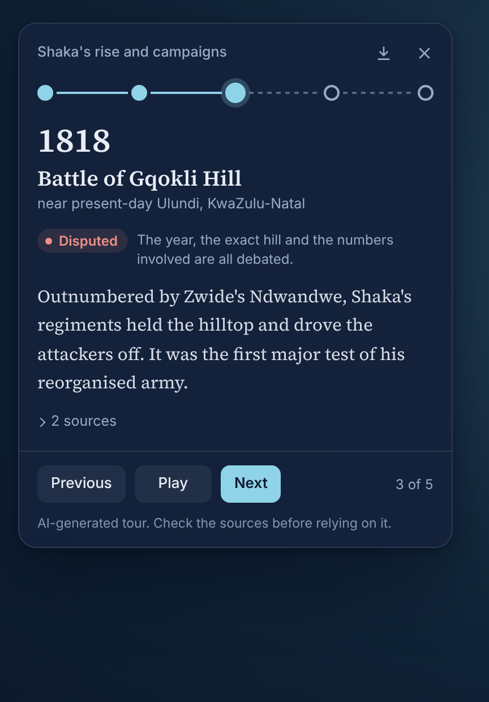
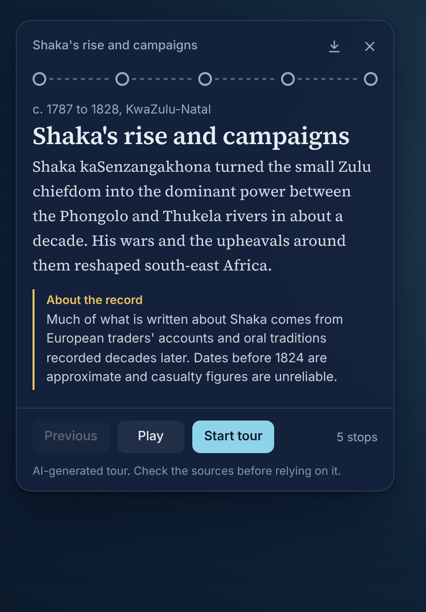

# Earth Tour

Historical journeys, flown on the real globe.

Type *"follow Shaka's campaigns"* and Google Earth flies you through it, stop by stop, with a short narration at each place, how sure historians are about it, and where the account comes from. Type a plain question like *"highest mountain in the world"* and it just takes you there.

<p>
  
  
</p>

> **Proof of concept.** It runs as an unpacked Chrome extension with your own Anthropic API key.

## Why this exists

Google Earth already has curated stories, but someone has to choose to make each one. Most of history never gets a tour, and African history in particular is thin. Earth Tour generates one on demand for any journey you can name, and flies the route instead of showing a slideshow.

Generated history is only useful if it's honest about its limits, so every stop carries:

- **A confidence label.** *Established* means historians broadly agree. *Approximate* means the event is accepted but the exact site or date isn't. *Disputed* means historians disagree, or the main sources are partisan.
- **A note on what exactly is uncertain**, for example "The year, the exact hill and the numbers involved are all debated."
- **Sources**, limited to real, well-known works, with "No sources cited" shown rather than an invented reference.
- **A note on the record** for the whole tour, saying where the history comes from (oral tradition, colonial-era accounts, court chronicles).

## Using it

| | |
|---|---|
| **Ctrl+K** on Google Earth or Maps | Opens the search palette over the map |
| **Alt+G** anywhere | Opens it from any tab |
| `ej` + space in the address bar | Jumps from the address bar |


- **Places and questions** fly straight there. If a phrase could mean several places ("Paris"), you pick from a short list.
- **Journeys** (phrases like *follow*, *trace*, *campaigns*, *voyage*, *expedition*, *hajj*) show a **Tour** label and open as a tour in Earth.
- **In a tour:** ← and → step between stops, **Play** advances on its own, and the route track at the top shows where you are. Download the tour as **KML** and import it into an Earth project to see the route drawn as a line.

## Install

1. Download or clone this repo.
2. Open `chrome://extensions` and turn on **Developer mode**.
3. Click **Load unpacked** and choose the `extension` folder.
4. Settings open on first install. Paste an [Anthropic API key](https://console.anthropic.com/).
5. Reload any Google Earth or Maps tabs you already had open.

## How it works

```
phrase ──▶ Claude ──▶ places or a tour (JSON) ──▶ camera URLs ──▶ Earth flies there
```

- **Places:** Claude Haiku turns the phrase into ranked candidates. The chosen one is snapped to precise coordinates with OpenStreetMap's Nominatim, but only if the snap lands near Claude's guess, so ocean trenches and unnamed sites keep their own coordinates.
- **Tours:** Claude Sonnet plans 5 to 12 chronological stops, each with coordinates, camera distance, narration, confidence and sources. Tours are cached, so replaying one is instant.
- **Smooth flight:** on Earth, the extension changes the page URL in place instead of navigating. Earth's own router picks that up and animates a fly-to, with no reload. The browser's Back button flies you back. This relies on undocumented Earth behaviour, so if it stops working the extension falls back to a normal page load.

| File | What it does |
|---|---|
| `background.js` | Claude calls, geocoding, caching, tab handling, Alt+G, address bar |
| `palette-ui.js` | The search palette, shared by the in-page overlay and the toolbar popup |
| `tour-ui.js` | The tour panel, route track, autoplay and KML export |
| `content.js` | Runs on Earth and Maps: injects the UI, routes keys, flies the camera |

## Limits

- **The API key lives in the extension.** That's fine for personal use, but don't publish it to the Chrome Web Store like this. Put the API calls behind a small proxy first.
- **Tours are AI-generated.** The confidence labels and the note on the record make the uncertainty visible, but they don't remove it. Check the sources before relying on a tour.
- **Maps** still reloads on each jump. Only Earth gets the smooth fly-to.

## Roadmap

- Hand-checked flagship tours, starting with southern African history, marked separately from generated ones
- Draw the route on the globe during a tour, not only through KML
- Share a tour as a link

## Credits

Text in the tour panel is set in [Source Serif 4](https://github.com/adobe-fonts/source-serif) by Adobe, under the SIL Open Font License (see `extension/fonts/OFL-LICENSE.txt`). Geocoding by [OpenStreetMap Nominatim](https://nominatim.org/). Not affiliated with Google.

## License

MIT
