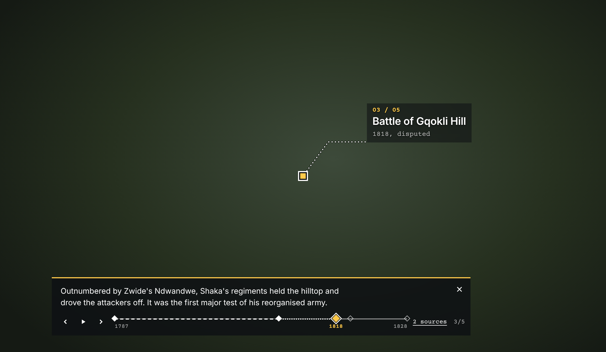
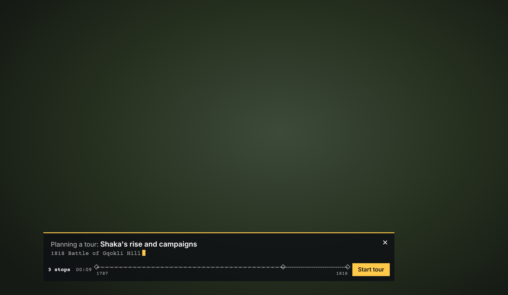
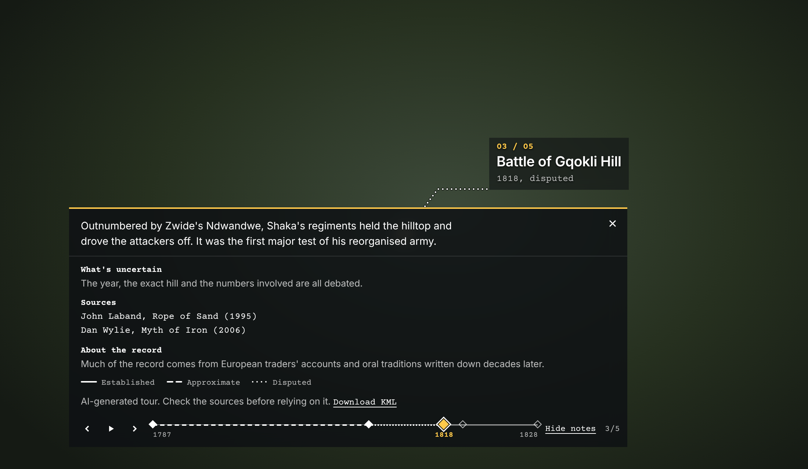

# Earth Tour

Historical journeys, flown on the real globe.

Type *"follow Shaka's campaigns"* and Google Earth flies you through it, stop by stop. Each stop is marked on the map and narrated along the bottom, with a note on how sure historians are and where the account comes from. Type a plain question like *"highest mountain in the world"* and it just takes you there.



> **Proof of concept.** It runs as an unpacked Chrome extension with your own Anthropic API key.

## Why this exists

Google Earth already has curated stories, but someone has to choose to make each one. Most of history never gets a tour, and African history in particular is thin. Earth Tour generates one on demand for any journey you can name, and flies the route instead of showing a slideshow.

Generated history is only useful if it's honest about its limits, so certainty is built into the design:

- **Line style means certainty, the way it does on real maps.** Surveyed borders are drawn solid, approximate ones dashed, disputed ones dotted. Earth Tour uses the same convention for the leader line to each stop's label and for each leg of the timeline. *Established* means historians broadly agree, *approximate* means the event is accepted but the exact site or date isn't, and *disputed* means historians disagree or the main sources are partisan.
- **Every stop says what's uncertain** ("The year, the exact hill and the numbers involved are all debated").
- **Sources are real, well-known works**, and a stop shows "No sources cited" rather than an invented reference.
- **Each tour notes where its record comes from**: oral tradition, colonial-era accounts, court chronicles.

## The design

The map is the interface. Nothing sits in a corner competing with it.

- **On the map:** an atlas-style label pinned to the stop, joined by a leader line in the stop's certainty style. Satellite imagery is busy, so labels are white on a soft dark backing, with one survey-yellow highlight marking where you are.
- **Along the bottom:** a documentary-style band. The narration reads like subtitles, and the timeline underneath is the scrubber. Stops sit at their real years, so ten quiet years read as a gap and three battles in two years read as a cluster.
- **While a tour is planned**, Earth flies to the region straight away, and stops drop onto the timeline as they're written. You can start as soon as stop 1 arrives.

<p>
  
  
</p>

## Using it

| | |
|---|---|
| **Ctrl+K** on Google Earth or Maps | Opens the search bar over the map |
| **Alt+G** anywhere | Opens it from any tab |
| `ej` + space in the address bar | Jumps from the address bar |


- **Places and questions** fly straight there. If a phrase could mean several places ("Paris"), you pick from a short list.
- **Journeys** (phrases like *follow*, *trace*, *campaigns*, *voyage*, *expedition*, *hajj*) show a **Tour** label and open as a tour in Earth.
- **In a tour:** ← and → step between stops, and clicking a point on the timeline jumps there. **Play** (or Space) advances on its own, giving each stop time to read; the leg to the next stop fills in as the countdown. Dragging the map hides the marker; click the current point to fly back. **Notes** shows the uncertainty, sources, a legend and a **KML** download, which you can import into an Earth project to see the route drawn as a line.

## Install

1. Clone this repo: `git clone https://github.com/vitruvianman-za/earthtour`
2. Open `chrome://extensions` and turn on **Developer mode**.
3. Click **Load unpacked** and choose the `extension` folder.
4. Settings open on first install. Paste an [Anthropic API key](https://console.anthropic.com/).
5. Reload any Google Earth or Maps tabs you already had open.

To update later: `git pull`, then click reload on the extension card.

## How it works

```
phrase ──▶ Claude ──▶ places, or a tour streamed stop by stop ──▶ camera URLs ──▶ Earth flies there
```

- **Places:** Claude Haiku turns the phrase into ranked candidates. The chosen one is snapped to precise coordinates with OpenStreetMap's Nominatim, but only if the snap lands near Claude's guess.
- **Tours:** Claude Sonnet writes 5 to 12 chronological stops. The reply is streamed, and each stop is picked out of the partial JSON the moment it's complete, so the tour can start before it's finished. The schema puts the stops before the longer summary text, so stop 1 isn't waiting on two paragraphs. At the same time, a quick Claude Haiku call names the region so Earth can start flying there.
- **Fast or careful:** by default, tours are written at medium effort without thinking first, so stops start streaming within seconds. Choose **Careful** in Settings to have Claude think the whole journey through first: slower to start, potentially more accurate. Quick lookups (places, region) run Haiku at low effort with thinking off.
- **Renamed places:** each stop carries its historical name for display and, separately, a modern place name used only for geocoding. A stop is only snapped when it happened in that modern place itself, so "near present-day Ulundi" is never moved to Ulundi's town centre.
- **Valid output:** every Claude call uses structured outputs, so replies always match the schema. A stray quote in a narration can't break a tour.
- **Smooth flight:** on Earth, the extension changes the page URL in place instead of navigating. Earth's own router picks that up and animates a fly-to, with no reload, and the browser's Back button flies you back. This relies on undocumented Earth behaviour, so if it stops working the extension falls back to a normal page load.
- **Caching:** finished tours and geocodes are cached, so replaying a tour is instant and makes no API calls.

| File | What it does |
|---|---|
| `background.js` | Claude calls and streaming, the live tour state, geocoding, caching, tab handling, Alt+G, address bar |
| `tour-ui.js` | The map annotation, the documentary band, the timeline, autoplay and KML export |
| `palette-ui.js` | The search bar, shared by the in-page overlay and the toolbar popup |
| `content.js` | Runs on Earth and Maps: injects the UI, follows tour updates, routes keys, flies the camera |

## Limits

- **The API key lives in the extension.** That's fine for personal use, but don't publish it to the Chrome Web Store like this. Put the API calls behind a small proxy first.
- **Tours are AI-generated.** The certainty styles and notes make the uncertainty visible, but they don't remove it. Check the sources before relying on a tour.
- **The marker assumes the stop is at the centre of the view,** which is where Earth lands. It hides when you drag the map rather than trying to follow it.
- **Maps** still reloads on each jump. Only Earth gets the smooth fly-to.

## Roadmap

- Hand-checked flagship tours, starting with southern African history, marked separately from generated ones
- Draw the route on the globe during a tour, not only through KML
- Share a tour as a link

## Credits

Set in [Inter](https://github.com/rsms/inter) by Rasmus Andersson and [Courier Prime](https://quoteunquoteapps.com/courierprime/) by Alan Dague-Greene, both under the SIL Open Font License (see `extension/fonts/`). Geocoding by [OpenStreetMap Nominatim](https://nominatim.org/). Not affiliated with Google.

## License

MIT
